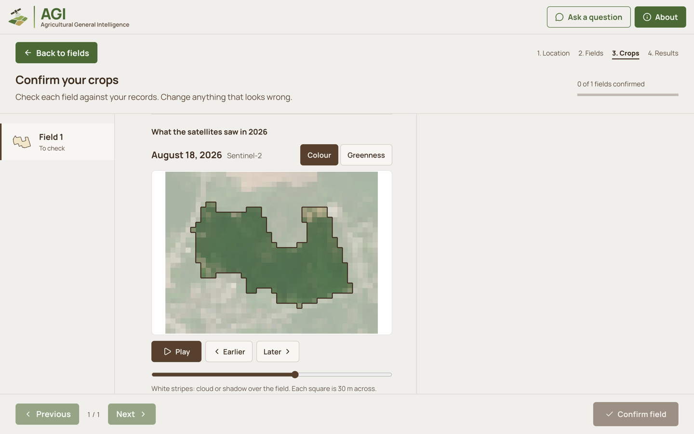
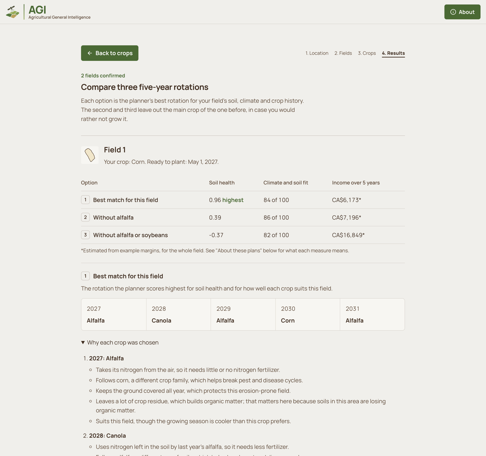

# AGI: crop rotation planning from NASA data

AGI (Agricultural General Intelligence) helps a farmer plan the next five years of
crops for their own fields. You find your farm on a map, pick your fields, check what
satellites say grew there, and get three rotations to compare, each explained year by
year. A built-in assistant answers questions about the fields using the same data.

We built it for the NASA Space Apps Challenge 2026, as the team Green Alien House
Party. The challenge asked how NASA data could help farmers protect soil health while
choosing what to grow. Our answer starts from the individual field, not the region:
every number the app shows is measured for the outline the farmer selected.

Try it at <https://www.agi-spaceapps.earth>.



## How it works for a farmer

1. **Location.** Search an address or town, or use your current location. The map
   opens on your area.
2. **Fields.** Tap your fields on the map, or shift-drag a box to select several. Outlines
   come from a satellite-derived field map, so there is nothing to draw.
3. **Crops.** For each field, the app shows what the crop maps recorded in each of the
   last five years and suggests this season's crop. Next to it, the field's latest
   growing season plays back as NASA saw it: one picture for every clear satellite
   pass, and a greenness line from planting to harvest. The farmer confirms or corrects
   the crop and gives a date when the field is free to plant. Their answer always
   overrides the map.
4. **Results.** Three five-year rotations per field: the best match, then the best
   without its main crop, then without the next one, in case the farmer would rather
   not grow it. Each is compared on soil health, how well the crops suit this field's
   climate and soil, and estimated income, with the reason for every crop in every year.

"Ask a question" opens an assistant that knows which fields are on screen and what
the farmer confirmed. It looks things up rather than guessing: soil, weather, drought,
crop calendars, market prices, and the same planner, and it lists every lookup it made.



## What we built

The project is three repositories that deploy together:

| Repository | Language | What it does |
| --- | --- | --- |
| [spaceapps-2026-frontend](https://github.com/Erric-Cheung/spaceapps-2026-frontend) (this one) | React, TypeScript | The four-step app, the map, the season playback and the assistant panel |
| [SpaceApps2026-Backend](https://github.com/chrisbarbati/SpaceApps2026-Backend) | Java, Spring Boot | The rotation planner, crop history interpretation, season quality rules and the AI assistant with its tools |
| [spaceapps-2026-data](https://github.com/insertusernamed/spaceapps-2026-data) | Python, FastAPI | Field outlines and every satellite, weather and soil lookup, cut to each field's outline |

During the hackathon we:

- **Indexed 353,809 predicted field outlines across Ontario** from Fields of the World,
  so any field in the province can be selected by tapping it. Fields load for the
  visible map area as you zoom in.
- **Read each field's crop history** from Agriculture and Agri-Food Canada's Annual
  Crop Inventory (Ontario from 2011) and the USDA Cropland Data Layer (from 2008), as
  the share of the field each crop covered, year by year.
- **Showed the field's season at the pixel level.** The data service reads NASA's
  Harmonized Landsat and Sentinel-2 (HLS) scenes for just the field and a margin
  around it, cloud mask first, and streams pictures as they are ready. A full season
  of about 130 satellite passes arrives in about a minute the first time, with the
  first picture after about ten seconds, and in about five seconds after that. The page
  draws every 30 m square as measured, stripes the clouds, and opens on the greenest
  day.
- **Built a planner** that finds the highest-scoring five-year sequence for each field,
  scoring each year on soil health (breaking pest and disease cycles, nitrogen, residue and
  ground cover), on how reliably the crop has suited the field's own climate record and
  soil, and on income.
- **Built an assistant** on Spring AI with 23 tools that call the same
  services the app uses, streams its answers, falls back to another model if one fails,
  and can propose a rotation for the farmer to accept or reject.
- **Kept it usable for anyone.** Plain words, 44 px touch targets, keyboard selection of
  map fields, screen reader announcements, and layouts checked in a real browser at
  desktop and phone sizes.

## The data behind it

| Source | What we use it for |
| --- | --- |
| NASA HLS v2.0 (Landsat 8/9 and Sentinel-2, 30 m) | Season pictures and field greenness, every few days |
| NASA POWER | Daily weather and the climate record: frost dates, heat, rainfall, water balance |
| NASA MODIS | Up to 25 years of vegetation history at 16-day steps |
| NASA GRACE and GRACE-FO | Groundwater and soil moisture drought indicators |
| NASA SMAP | Soil moisture layer in the data API |
| NASA SRTM | Elevation, slope and erosion rating |
| AAFC Annual Crop Inventory, USDA Cropland Data Layer | What grew in each field each year |
| Fields of the World (CC BY 4.0) | Field outlines |
| SoilGrids, AAFC Soil Landscapes of Canada | Soil texture, pH, organic carbon, drainage and land capability |
| GGCMI crop calendar, FAO ECOCROP | Planting and maturity dates, and each crop's tolerated conditions |
| Environment and Climate Change Canada, Statistics Canada | Seasonal outlook, provincial yields and prices |
| OpenStreetMap through Photon and OpenFreeMap | Address search and the basemap |

## What it cannot tell you

- Field outlines are predictions from satellite imagery. They are not property lines,
  and one outline can cover two fields.
- Crop maps are classifications and can be wrong for any year, especially at field
  edges. That is why the farmer confirms every crop.
- Greenness measures green leaf. It cannot tell a dry spell from a harvest, or a cover
  crop from weeds, and clouds leave gaps of weeks. The app shows those gaps instead of
  filling them.
- Some planner inputs are estimates we chose to be plausible for southern Ontario, not
  sourced figures: each crop's nitrogen balance, residue, disease susceptibility and net
  margin. The results page says which numbers these are. The plans are a starting
  point for a conversation with an agronomist, not a recommendation.

## How we used AI

We built this project with AI-driven development, using Claude (Anthropic) and Codex
(OpenAI) as coding assistants. They did not write the project on their own, but they
sped up our work considerably. The team chose the problem, the approach, the data
sources and the design, directed the assistants, and reviewed and tested their changes
before merging them.

In this repository, the assistants wrote and revised much of the React and TypeScript
code, including the season playback on the Crops step, ran tests and browser checks,
and drafted documentation, including this README. The backend and data repositories
were built the same way.

The app's icon (`public/logo.png`, used as the favicon and in the header) is
AI-generated. The screenshots in this README are of the running app.

The app itself also uses a language model: "Ask a question" sends the farmer's
question, and what is on screen, to an OpenAI-compatible model, and its answers are
generated text. It looks facts up with the app's own data tools and lists every lookup
it made. The rotation plans and every number on the Crops and Results pages are
calculated by the planner and data services, not generated.

## Running it yourself

You need Node 22.18 or newer and the Java API running somewhere (see the backend
repository; it in turn needs the data service).

```sh
cp .env.example .env     # set API_URL to the Java API
npm install
npm run dev
```

The browser calls `/api/*` and the Vite dev server forwards it to `API_URL`. Checks:

```sh
npm run build
npm run lint
node --test tests/*.test.ts
```

[docs/DEVELOPMENT.md](docs/DEVELOPMENT.md) explains how each part of the frontend
works: field selection and crop history loading, the assistant panel, the season
playback's polling, map navigation limits, and running a local planner.

## Team

Christian Barbati, Eric Cheung, Jenna Deamer and insertusernamed, as Green Alien House
Party.

Map data © OpenStreetMap contributors, OpenMapTiles. Field outlines: Fields of the
World, Global 2nd Edition (CC BY 4.0). Satellite data courtesy of NASA, USGS, ESA
Copernicus, Agriculture and Agri-Food Canada and USDA NASS.
